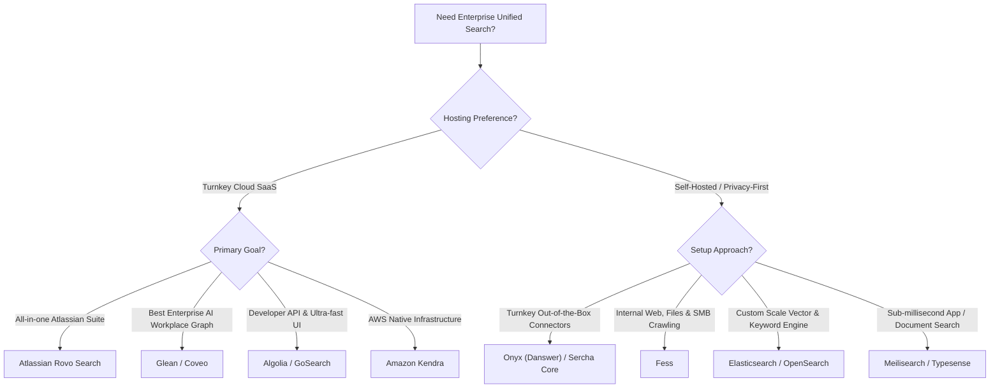

# 🔍 Awesome Enterprise Unified Search 🚀

 

  <b>A comprehensive, SEO-optimized, curated guide to next-generation Enterprise Unified Search engines, AI-powered workplace knowledge assistants, and self-hosted open-source neural retrieval systems.</b>

  <a href="#-sector-overview--market-dynamics">Sector Overview</a> •
  <a href="#-saas--hosted-platforms">SaaS &amp; Commercial Platforms</a> •
  <a href="#-open-source-software">Open-Source Engines</a> •
  <a href="#-feature-matrix--comparison-at-a-glance">Feature Matrix</a> •
  <a href="#-contributing">Contributing</a>

---

> 🌟 **Star this repository if you find it helpful!** 🌟  
> Enterprise Unified Search bridges organizational silos by connecting structured and unstructured data across SaaS apps (Google Drive, Notion, Confluence, Slack, Jira, GitHub) and enterprise data lakes using semantic AI, neural embeddings, hybrid BM25 lexical search, and permission-aware RAG (Retrieval-Augmented Generation).

---

## 📑 Table of Contents

- [🌐 Sector Overview & Market Dynamics](#-sector-overview--market-dynamics)
- [🟦 SaaS / Hosted Platforms](#-saas--hosted-platforms)
  - [Commercial Vendor Leaderboard](#-commercial-vendor-leaderboard-sorted-by-scale)
  - [Deep Dives & Capabilities](#-deep-dives--capabilities)
- [🟩 Open-Source Software](#-open-source-software)
  - [Open-Source Solutions Leaderboard](#-open-source-solutions-leaderboard-sorted-by-github-stars)
  - [Open-Source Architecture Deep Dives](#-open-source-architecture-deep-dives)
- [📊 Feature Matrix & Comparison at a Glance](#-feature-matrix--comparison-at-a-glance)
- [💡 Choosing the Right Search Architecture](#-choosing-the-right-search-architecture)
- [💖 Support & Sponsorship](#-support--sponsorship)
- [⭐ Star History](#-star-history)
- [🤝 Contributing](#-contributing)
- [📄 License](#-license)

---

## 🌐 Sector Overview & Market Dynamics

The global enterprise search market is currently valued between **$5.4 billion and $7.7 billion**, with market projections estimating expansion to **$11 billion – $16 billion by 2034** at an accelerating **CAGR of ~8.5% to 11.3%**, spurred by the rapid adoption of enterprise generative AI, hybrid BM25 + dense vector retrieval, and conversational Retrieval-Augmented Generation (RAG).

Market structure analysis reveals that the sector is **moderately concentrated at the core infrastructure layer**—where hyperscalers (Microsoft, AWS, Google Cloud) and established players like Elastic capture 35–45% of platform spend—yet **heavily fragmented across the application and specialized AI layer**, where fast-growing pure-play innovators (Glean, AlphaSense, Coveo, Sinequa) and modern open-source alternatives compete intensely on permission-aware governance, out-of-the-box connectors, and agentic workflows.

---

## 🟦 SaaS / Hosted Platforms

Enterprise SaaS search platforms deliver turnkey, cloud-hosted unified search across company SaaS ecosystems with zero DevOps overhead, out-of-the-box identity governance (SSO/SAML/SCIM), and automated access control list (ACL) mirroring.

### 🏆 Commercial Vendor Leaderboard (Sorted by Scale)

The table below outlines enterprise SaaS unified search vendors sorted descending by company scale (market valuation / market capitalization / revenue):

| Platform | Company Scale (Valuation / Market Cap / Rev) 🏢 | Starting Tier Pricing 🏷️ | Free Tier Limits / Free Trial Plan 🎁 | Primary Specialization 🎯 | Deployment Models ☁️ |
|:---|:---|:---|:---|:---|:---|
| **[Amazon Kendra](https://aws.amazon.com/kendra/)** | ~$2,600,000,000,000 ($2.6T MCap) | **$0.32/hour** (~$230.40/month, GenAI Enterprise Edition base index) | **750 free hours for first 30 days** on GenAI Enterprise or Developer Edition (connector syncing charged standard) | AWS-native managed semantic search & GenAI RAG index | AWS Cloud |
| **[Atlassian Rovo Search](https://www.atlassian.com/software/rovo)** | ~$52,000,000,000 ($52B MCap) | **$5/user/month** (Rovo Standard standalone seat) or bundled in Jira/Confluence paid tiers ($8.15+/user/mo) | **No standalone free plan**; 350 Rovo Dev credits/user/mo included on paid Jira plans (0 credits on Free Atlassian tiers) | Native Atlassian ecosystem + 50+ third-party connected tools | Atlassian Cloud |
| **[Elastic Cloud Serverless](https://www.elastic.co/enterprise-search)** | ~$10,200,000,000 ($10.2B MCap) | **$99/month** (standard hosted) or **$0.01+/VCU-hour** consumption meter (Serverless search compute) | **14-day free trial** with full serverless project creation and vector inference access | Search AI Lake, vector search, and scalable enterprise search | Multi-cloud (AWS, GCP, Azure) |
| **[AlphaSense](https://www.alpha-sense.com/)** | ~$7,500,000,000 ($7.5B Valuation) | **$10,000/user/year** (~$833/user/month, 3–5 seat min. commit) | **No self-serve free trial**; invitation-only restricted corporate pilot upon sales demo approval | Financial market intelligence, SEC filings, and broker research | Cloud SaaS |
| **[Glean](https://www.glean.com/)** | ~$7,200,000,000 ($7.2B Valuation) | **$45/user/month** (typical contract baseline; 50–100 seat minimum, ~$30k–$50k/year ARR base) | **No self-serve free tier**; custom sales-assisted POC (Proof of Concept) on qualifying enterprise demos | Enterprise AI workplace search & autonomous company agents | Multi-cloud / Hybrid VPC |
| **[Algolia](https://www.algolia.com/)** | ~$2,300,000,000 ($2.3B Valuation) | **$0/month base** ($0.50 per 1,000 extra search requests on Grow plan) | **Free forever plan ("Build")**: 10,000 search requests/month + 50,000 records + 5,000 recommendations/mo | API-first hybrid neural & keyword search for apps & portals | Global Edge Cloud |
| **[Coveo](https://www.coveo.com/)** | ~$320,000,000 ($320M MCap / ~$450M CAD) | **$990/month** (Salesforce Pro+ package; enterprise baseline from ~$1,200/month) | **14-day free trial** (full access to AI relevance models & connectors, no credit card required) | AI-powered relevance and unified indexing across hybrid/cloud portals | Multi-cloud / SaaS |
| **[Lucidworks](https://lucidworks.com/)** | ~$300,000,000 ($300M Val / ~$50M ARR) | **~$3,500/month** (~$42,000/year entry enterprise agreement) | **No self-serve free trial**; guided proof-of-concept (POC) license available via sales qualification | Containerized cloud-native search and predictive machine learning | Cloud / Kubernetes |
| **[GoSearch](https://www.gosearch.ai/)** | ~$127,000,000 ($127M Val / ~$15M ARR) | **$20/user/month** (GoSearch Pro tier) | **Free forever tier**: 10 searches/day + 3–5 GoAI queries/day + 1 file upload (max 5 MB limit) | Workplace search across diverse tech stacks (Drive, Slack, Notion) | Cloud SaaS |
| **[Sinequa](https://www.sinequa.com/)** | ~$20,000,000+ ARR (Acquired by ChapsVision) | **~$4,166/month** (~$50,000/year entry baseline via Azure Marketplace private offers) | **No self-serve free trial**; hands-on sandbox & structured live demo via sales qualification | Cognitive search and domain-tuned AI agents for manufacturing/finance | Hybrid / Azure / Private Cloud |

---

### 🔍 Deep Dives & Capabilities

#### 🔹 [Atlassian Rovo Search](https://www.atlassian.com/software/rovo)
- **Architecture:** AI-powered unified search natively embedded within Jira, Confluence, Service Management, Slack, Google Drive, SharePoint, and GitHub.
- **Key Features:** Intent-aware routing, natural language synthesis with exact citation links, and visual inline cards.
- **Enterprise Strengths:** 74% increase in finding Jira artifacts; zero connector setup required for existing Atlassian tenants.

#### 🔹 [Glean](https://www.glean.com/)
- **Architecture:** Comprehensive workplace intelligence platform grounded on an enterprise search foundation with deep continuous crawling.
- **Key Features:** Deep enterprise context graph, native Assistants, automated AI Agents, and full permission preservation (respects source ACLs in real time).
- **Enterprise Strengths:** Surpassed $300M ARR; trusted by Fortune 500 leaders across multiple cross-functional departments.

#### 🔹 [Elastic Cloud Serverless](https://www.elastic.co/enterprise-search)
- **Architecture:** Search AI Lake decoupled architecture powering vector search, BM25 text retrieval, and ELSER semantic reranking.
- **Key Features:** Open connector ecosystem, automated vector embedding generation, zero infrastructure capacity planning, and sub-second querying.
- **Enterprise Strengths:** Elastic powers over 36% of enterprise production search deployments globally.

#### 🔹 [Algolia](https://www.algolia.com/)
- **Architecture:** Ultra-low latency API-first search engine providing hybrid keyword + dense vector retrieval (NeuralSearch).
- **Key Features:** Instant search as-you-type, built-in A/B testing, personalization engine, and crawler pipelines for enterprise content.
- **Enterprise Strengths:** Extremely generous permanent free tier with millisecond edge distribution worldwide.

#### 🔹 [Amazon Kendra](https://aws.amazon.com/kendra/)
- **Architecture:** AWS fully-managed natural language cognitive search engine with pretrained domain-specific NLP models.
- **Key Features:** Native connectors to S3, SharePoint, Salesforce, ServiceNow, RDS, and Jira; automated document excerpt extraction.
- **Enterprise Strengths:** Direct integration with AWS IAM, CloudWatch, and Amazon Bedrock for generative RAG workflows.

#### 🔹 [Coveo](https://www.coveo.com/)
- **Architecture:** Unified AI search platform layering over hybrid on-premises repositories and cloud knowledge bases.
- **Key Features:** Machine learning relevance tuning, automatic search suggestions, generative answering with strict source grounding.
- **Enterprise Strengths:** Pre-built certified integrations for Salesforce, ServiceNow, SAP, and Sitecore environments.

#### 🔹 [AlphaSense](https://www.alpha-sense.com/)
- **Architecture:** Vertical AI search engine tailored specifically for financial, market, and competitive intelligence.
- **Key Features:** Ingestion of SEC filings, investor presentations, Wall Street broker research, regulatory feeds, and proprietary company content.
- **Enterprise Strengths:** Natural language sentiment detection and smart synonyms tuned for financial vocabulary.

#### 🔹 [GoSearch](https://www.gosearch.ai/)
- **Architecture:** Turnkey workplace search engine designed for modern hybrid software stacks.
- **Key Features:** Unified queries across Notion, Google Workspace, GitHub, Coda, and Slack; automated file verification and deprecation tracking.
- **Enterprise Strengths:** Lowest barrier to entry with a perpetual free plan and rapid 5-minute setup.

---

## 🟩 Open-Source Software

Self-hosted, developer-friendly, and privacy-respecting search platforms that allow you to retain complete ownership of your proprietary organizational data.

### 🌟 Open-Source Solutions Leaderboard (Sorted by GitHub Stars)

The table below is sorted descending by GitHub stargazers count:

| Repository & Name | GitHub Star Badge 🏷️ | Core Tech Stack ⚙️ | License 📜 | Best For 💡 |
|:---|:---|:---|:---|:---|
| **[Firecrawl](https://github.com/mendableai/firecrawl)** |  | TypeScript / Python | AGPL-3.0 | Web & enterprise documentation web crawler converting messy content into clean Markdown/RAG data |
| **[RAGFlow](https://github.com/infiniflow/ragflow)** |  | Python / C++ | Apache 2.0 | Deep document understanding & unified context engine across complex PDFs, slides, and tables |
| **[Elasticsearch](https://github.com/elastic/elasticsearch)** |  | Java / Lucene | ELv2 / SSPL / AGPL | Industry-standard distributed full-text, vector search, and analytical knowledge engine |
| **[Meilisearch](https://github.com/meilisearch/meilisearch)** |  | Rust | MIT | Blazing-fast, typo-tolerant, instant search-as-you-type with zero complex configuration |
| **[Milvus](https://github.com/milvus-io/milvus)** |  | Go / C++ | Apache 2.0 | Massive-scale billion-vector similarity search engine and enterprise neural retrieval backend |
| **[Khoj](https://github.com/khoj-ai/khoj)** |  | Python | AGPL-3.0 | Self-hosted AI personal and team knowledge assistant searching markdown, PDFs, Notion, and GitHub |
| **[Qdrant](https://github.com/qdrant/qdrant)** |  | Rust | Apache 2.0 | High-performance vector database with payload-based filtering for AI semantic enterprise search |
| **[Onyx (formerly Danswer)](https://github.com/onyx-dot-app/onyx)** |  | Python / TypeScript | MIT | Open-source enterprise unified search & workplace assistant with 30+ native connectors (Slack, Drive, Jira) |
| **[Typesense](https://github.com/typesense/typesense)** |  | C++ | GPL-3.0 | Fast, typo-tolerant open-source alternative to Algolia with native vector search and federated search |
| **[ZincSearch](https://github.com/zinclabs/zincsearch)** |  | Go / Vue | Apache 2.0 | Lightweight alternative to Elasticsearch requiring minimal CPU/RAM resources |
| **[Weaviate](https://github.com/weaviate/weaviate)** |  | Go | BSD-3-Clause | Cloud-native multimodal vector engine combining keyword BM25 and vector search out-of-the-box |
| **[OpenSearch](https://github.com/opensearch-project/OpenSearch)** |  | Java / Lucene | Apache 2.0 | 100% community-driven, Apache-licensed enterprise search and analytics engine |
| **[DataHub](https://github.com/datahub-project/datahub)** |  | Java / Python / TS | Apache 2.0 | Extensible metadata platform and unified search catalogue for enterprise data stacks |
| **[Quickwit](https://github.com/quickwit-oss/quickwit)** |  | Rust | AGPL-3.0 | Cloud-native search engine designed to execute sub-second queries directly on object storage (S3/GCS) |
| **[Vespa](https://github.com/vespa-engine/vespa)** |  | C++ / Java | Apache 2.0 | Advanced production serving engine for vector search, lexical matching, and real-time ML ranking |
| **[Amundsen](https://github.com/amundsen-io/amundsen)** |  | Python / TypeScript | Apache 2.0 | Metadata-driven enterprise data discovery tool indexing tables, dashboards, and streams |
| **[Apache Solr](https://github.com/apache/solr)** |  | Java / Lucene | Apache 2.0 | Highly reliable, battle-tested distributed search platform with advanced faceting |
| **[Fess](https://github.com/codelibs/fess)** |  | Java | Apache 2.0 | Turnkey self-hosted enterprise search server with web, file-system, and cloud storage crawlers |
| **[Sercha Core](https://github.com/sercha-core/sercha-core)** |  | Go / Vespa | Apache 2.0 | Dedicated self-hosted enterprise search engine connecting Slack, Notion, GitHub, Drive, and Jira |

---

### 🛠️ Open-Source Architecture Deep Dives

#### 🔹 [Onyx (formerly Danswer)](https://github.com/onyx-dot-app/onyx)
- **Architecture:** Full-stack unified search engine connecting enterprise data repositories (Confluence, Jira, Google Drive, Notion, Slack, GitHub, Linear, Zendesk).
- **Security & Permissions:** Native user-level authorization synchronization (OAuth2, OIDC, SAML). Respects document permissions dynamically during search.
- **RAG & Agents:** Built-in generative AI answers with hyperlinked source citations, custom assistants, and hybrid retrieval (dense vector embeddings + BM25).

#### 🔹 [Fess](https://github.com/codelibs/fess)
- **Architecture:** Robust, easy-to-deploy enterprise search server built on top of OpenSearch/Elasticsearch.
- **Crawler System:** Deeply crawls internal intranet portals, file shares (Samba/SMB, NFS), database servers, and multi-format documents (PDF, Office, Zip).
- **Interface & Admin:** Out-of-the-box multilingual web UI, query autocompletion, role-based access control, and comprehensive REST APIs.

#### 🔹 [Khoj](https://github.com/khoj-ai/khoj)
- **Architecture:** Offline-first and self-hosted AI knowledge orchestrator.
- **Connectors:** Native plugins for Obsidian, Emacs, desktop file directories, Notion, and GitHub repos.
- **Features:** Allows querying unstructured personal/enterprise notes with open-source LLMs (Llama, Mistral) or hosted models with privacy preservation.

#### 🔹 [OpenSearch](https://github.com/opensearch-project/OpenSearch)
- **Architecture:** Fully open-source Lucene fork stewarded by the OpenSearch Foundation and Linux Foundation.
- **Capabilities:** High-volume lexical search, distributed indexing, KNN vector search plugins, and complete dashboard visualization tooling.

#### 🔹 [Vespa](https://github.com/vespa-engine/vespa)
- **Architecture:** Industrial-grade big data serving engine engineered by Yahoo to evaluate billions of items in milliseconds.
- **Hybrid Retrieval:** Multi-phase ranking executing vector embeddings, BM25, and deep ONNX neural models simultaneously at wire speed.

---

## 📊 Feature Matrix & Comparison at a Glance

| System | Deployment Model | License | Native Work Connectors 🔌 | Semantic / Vector Search 🧠 | Permission Sync (ACLs) 🔒 | Starting Tier Cost 🏷️ |
|:---|:---|:---|:---:|:---:|:---:|:---|
| **Onyx (Danswer)** | Self-Hosted / Cloud | MIT | 30+ Tools | ✅ Hybrid | ✅ Full OAuth/SAML | **Free Open-Source** |
| **Glean** | Cloud SaaS / VPC | Proprietary | 100+ Tools | ✅ Dense Neural | ✅ Full Source ACL | **~$45/user/month** |
| **Atlassian Rovo** | SaaS | Proprietary | 50+ Tools | ✅ Hybrid | ✅ Atlassian ACL | **$5/user/month** |
| **Elasticsearch** | Self-Hosted / Cloud | ELv2 / AGPL | Via Connectors | ✅ Vector / ELSER | ✅ Role-based | **Free Open-Source** |
| **Sercha Core** | Self-Hosted | Apache 2.0 | 11+ Tools | ✅ Vespa Hybrid | ✅ OAuth2 | **Free Open-Source** |
| **Coveo** | Cloud SaaS | Proprietary | Hybrid On-prem/Cloud| ✅ Machine Learning | ✅ Enterprise ACL | **$990/month** |
| **Amazon Kendra** | AWS Cloud | Proprietary | AWS + Cloud Apps | ✅ Deep Learning | ✅ AWS IAM / Sync | **$0.32/hour** |
| **Algolia** | Edge SaaS | Proprietary | App / Web Data | ✅ NeuralSearch | ⚠️ Application Level | **Free tier / $0 base** |
| **Meilisearch** | Self-Hosted / Cloud | MIT | Ingestion API | ✅ Vector Search | ⚠️ Tenant Keys | **Free Open-Source** |
| **Typesense** | Self-Hosted / Cloud | GPL-3.0 | Ingestion API | ✅ Built-in Vectors | ⚠️ Scoped API Keys | **Free Open-Source** |
| **Fess** | Self-Hosted | Apache 2.0 | Web / SMB / DB | ✅ RAG / Plugins | ✅ Role / User ACL | **Free Open-Source** |
| **GoSearch** | Cloud SaaS | Proprietary | 20+ SaaS Tools | ✅ Generative AI | ✅ SSO / SCIM | **Free tier / $20/user/mo**|
| **Vespa** | Self-Hosted / Cloud | Apache 2.0 | Ingestion API | ✅ Multi-phase Rank | ⚠️ Application Level | **Free Open-Source** |

---

## 💡 Choosing the Right Search Architecture

---

## 🤝 Contributing

Contributions are warmly encouraged! Whether you want to add a missing open-source search framework, improve enterprise pricing accuracy, or share architectural benchmarks:

1. 🍴 **Fork** the repository.
2. 🌿 Create a feature branch: `git checkout -b feature/new-search-engine`.
3. ✍️ Add the project with GitHub links, license badges, and technical summaries.
4. 🚀 Submit a **Pull Request** detailing why the tool belongs in this curated index.

---

## 💖 Support & Sponsorship

Thank you so much for taking the time to explore this curated enterprise search resource! Keeping this directory up-to-date with emerging models, pricing shifts, and architectural advancements takes continuous research.

If you find this repository valuable, please consider supporting the project:
- ⭐ **Star** this repository on GitHub to boost visibility.
- 🍴 **Fork** and share it with your team, colleagues, or engineering network.
- ☕ **Buy me a coffee / Sponsor:** If this guide has saved you research hours or helped your team make key architectural decisions, support continued maintenance via the [GitHub Sponsors Dashboard](https://github.com/sponsors/ishandutta2007).

---

## ⭐ Star History

---

## 📄 License

This repository is licensed under the [Creative Commons Zero v1.0 Universal (CC0-1.0)](LICENSE) Public Domain Dedication.  
All linked third-party projects and trademarks are the property of their respective owners.

---

  <b>⭐ Found this curated list valuable? Star the repository to support continuous updates! ⭐</b>

